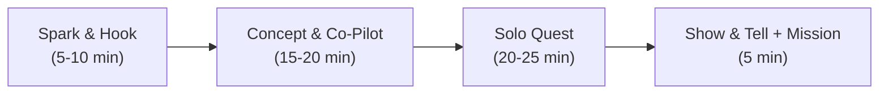

# STEMulus Kids Tech – 1-on-1 Mentorship Curriculum Repository

Welcome to the **STEMulus Kids Tech** master curriculum repository. This curriculum adapts the comprehensive adult professional tracks from **TS Academy (Tech Sphere Academy)** alongside custom youth foundational and Generative AI studios into an engaging, age-appropriate, project-based 1-on-1 mentorship system for kids and teens aged 5 to 18.

Every single lesson in the curriculum includes **granular instructional guides** and a **standalone, richly visual interactive HTML slide deck** designed for live 1-on-1 mentor screensharing or independent student review.

All slides feature a 3D playful minimalist light-mode aesthetic matching portal.stemuluskidstech.com, with neutral soft borders, transparent 3D assets, child-friendly typography, fail-safe dual-channel video architecture (embedded player plus direct 1-click YouTube launch), and zero unicode emojis.

---

## Master Slide Deck Portal

All **183 interactive slide decks** are indexed in the offline-ready Master Slide Deck Portal:
* **Master Web Portal:** [`slides/index.html`](./slides/index.html)
* **Direct Browser Launch:** [`file:///C:\Users\USER\.gemini\antigravity\scratch\curriculum\slides/index.html`](file:///C:\Users\USER\.gemini\antigravity\scratch\curriculum\slides/index.html)

### Slide Engine Highlights:
* **Fail-Safe Video Stage:** Embedded player alongside a direct 1-click **Watch on YouTube (2 Mins)** button that bypasses local browser `file:///` sandbox origin restrictions (Error 153 resilience), backed by offline child takeaway summaries and 60-second tutor debrief blueprints.
* **Course Toolkit Launcher:** Every course kicks off with explicit software installations or live sandbox links (CodePen, VS Code, Figma, Replit, Scratch, Colab, Wireshark, Kidlo, Blockly, Google AI Studio, Suno, Leonardo, Kling, ElevenLabs, Flowise, Phaser).
* **Keyboard & Touch Controls:** Advance with Right Arrow, Space, or Enter; reverse with Left Arrow; toggle fullscreen with F.
* **Mentor Speaker Notes:** Toggle the hidden speaker notes drawer with S for pacing cues, common pitfalls, and debugging prompts.
* **Interactive Checkpoint Quizzes:** Immediate validation with Web Audio API sound effects (synthesized oscillators; zero external audio files).
* **Tiered Solo Quests:** Every deck features Bronze (Core), Silver (Power-Up), and Gold (Boss Level) quest badges.
* **100% Offline Resilience:** Standalone CSS and vanilla JavaScript controller; zero external CDNs or dependencies.

---

## 1. Pedagogical Architecture

Each lesson represents a focused, **45–60 minute private 1-on-1 live mentoring session**:

### Standard Session Breakdown:
1. **The Spark / Hook (5–10 mins):** A relatable gaming mystery (Roblox/Minecraft/Discord) or visual dilemma to ignite interest.
2. **Concept & Co-Pilot Build (15–20 mins):** Guided visual breakdown followed by a collaborative hands-on build via screenshare.
3. **Solo Quest & Boss Challenges (20–25 mins):** The mentee takes the wheel with tiered achievements (Bronze, Silver, Gold).
4. **Show & Tell + Home Mission (5 mins):** The student demonstrates what they built, explains how it works, and receives a bite-sized home mission.
5. **Mentor Scaffolding & Speaker Notes:** Embedded in every slide deck via the S shortcut.

---

## 2. Age-Tier Calibration Matrix

| Age Tier | Focus & Cognitive Stage | Recommended Sandboxes | Pedagogical Rules |
| :--- | :--- | :--- | :--- |
| **Explorers (Ages 5–8)** | Intuitive play, spatial logic, narrative storytelling, directional arrows, basic loops, magic wand prompts. | Scratch Jr, Kidlo Coding, Code.org Pre-reader, Canva Magic, Suno | Zero syntax memorization; use colorful visual blocks, character animations, and tactile gaming metaphors. |
| **Creators (Ages 9–12)** | Visual-to-text bridge, design thinking, game mechanics, automation curiosity, conditionals, C-R-E-A-T-E prompts. | CodePen, Scratch, Figma for Edu, Replit, Leonardo.ai, Kling, Suno | Relate concepts to games they love; use immediate visual feedback; introduce typing syntax gradually. |
| **Innovators (Ages 13–18)** | Real-world industry syntax, full-stack architectures, modern AI tools, algorithms, StateGraphs, game engines. | VS Code, Replit, Vite/React, Figma, GitHub, Google AI Studio, Flowise, Phaser | Treat students as junior software engineers; encourage debugging and system design thinking. |

---

## 3. Master Track Catalog & Granular Slide Decks (183 Total Lessons)

### [Course 3: Generative AI Studio: Prompt, Loop & Graph Engineering](./course_ai_studio/) (24 Lessons across 3 Tracks)
Mastery of Prompt Engineering, Loop Engineering, and Graph Engineering applied across Storytelling, Animations, Music, Videos, and Game Development using free-to-use Gen AI platforms:
* **[Track 1: Early Explorers (Ages 5–7)](./course_ai_studio/early_explorers_ages_5_7.md) (8 Lessons):** Magic wand prompts, magic mirror loops, singing cloud machines, waking up drawings, story train maps, sound effect boxes, movie magic cutscenes, and playable Scratch story games.
  * *Slide Decks:* [Open Early Explorers AI Studio Slides](./slides/course_ai_studio/early_explorers_ages_5_7/lesson_01_magic_wand_prompt.html)
* **[Track 2: Junior Innovators (Ages 8–12)](./course_ai_studio/junior_innovators_ages_8_12.md) (8 Lessons):** C-R-E-A-T-E architect framework, critic-creator refinement loops, branching CYOA graphs, adaptive soundtrack scoring, sprite sheet animations, cinematic game trailers, generative NPC dialogue trees, and playable AI arcade capstone.
  * *Slide Decks:* [Open Junior Innovators AI Studio Slides](./slides/course_ai_studio/junior_innovators_ages_8_12/lesson_01_architect_prompt_framework.html)
* **[Track 3: Senior Engineers (Ages 13–18)](./course_ai_studio/senior_engineers_ages_13_18.md) (8 Lessons):** Deterministic JSON schema prompting, self-reflexion evaluation loops, StateGraphs and quest DAGs, procedural audio stems, LoRA animation pipelines, production video pipelines, LLM-powered dynamic NPC brains, and full-stack HTML5/Phaser web game releases.
  * *Slide Decks:* [Open Senior Engineers AI Studio Slides](./slides/course_ai_studio/senior_engineers_ages_13_18/lesson_01_deterministic_prompt_json_schema.html)

---

### [Course: Fundamental Concepts of Coding](./course_fundamentals/) (21 Lessons across 3 Tracks)
Foundational computational thinking, algorithms, repetition loops, conditionals, events, variables, functions, and debugging calibrated developmentally across three tracks:
* **[Track 1: Early Explorers (Ages 5–7)](./course_fundamentals/early_explorers_ages_5_7.md) (7 Lessons):** Robot dance algorithms, magic echo loops, traffic light conditionals, doorbell triggers, treasure chest variables, smoothie machine functions, and detective badge debugging.
  * *Slide Decks:* [Open Early Explorers Slides](./slides/course_fundamentals/early_explorers_ages_5_7/lesson_01_robot_dance_algorithms.html)
* **[Track 2: Junior Innovators (Ages 8–12)](./course_fundamentals/junior_innovators_ages_8_12.md) (7 Lessons):** Maze navigation sequences, repeat-until loops, if-else logic forks, event listeners, game scoreboard variables, reusable helper functions, and bug bounty debugging.
  * *Slide Decks:* [Open Junior Innovators Slides](./slides/course_fundamentals/junior_innovators_ages_8_12/lesson_01_step_by_step_maze_algorithms.html)
* **[Track 3: Senior Engineers (Ages 13–18)](./course_fundamentals/senior_engineers_ages_13_18.md) (7 Lessons):** Algorithmic recipes, while loops and iterations, ternary conditional logic, event-driven architectures, variable scoping, DRY modular functions with parameters, and stack trace debugging.
  * *Slide Decks:* [Open Senior Engineers Slides](./slides/course_fundamentals/senior_engineers_ages_13_18/lesson_01_computational_thinking_algorithms.html)

#### Core Coding Concepts Mastery Map

| Concept | What It Means (Simple Language) | Visual Real-World Analogy | Practice Platform & Working Game Link |
| :--- | :--- | :--- | :--- |
| **Algorithms & Sequences** | Step-by-step instructions in exact order | A recipe to bake cupcakes or brushing teeth step-by-step | [Blockly Maze](https://blockly.games/maze) / [Kidlo Sequencing](https://www.kidlocoding.com/games.php) |
| **Loops (Repetition)** | Doing an action multiple times without rewriting code | A music chorus repeating 3 times or pedaling a bike | [Code.org Express Courses](https://studio.code.org/) / [Blockly Turtle](https://blockly.games/turtle) |
| **Conditionals (If / Else)** | Making choices based on whether a rule is True or False | If it rains, take an umbrella; Else, wear sunglasses | [Blockly Bird Logic](https://blockly.games/bird) |
| **Events & Triggers** | An action that makes something happen | Ringing a doorbell to make a chime ring or pressing Space to Jump | [Scratch Ideas](https://scratch.mit.edu/ideas) / [Code.org Studio](https://studio.code.org/) |
| **Variables & Data** | Labeled containers that store information changing over time | A game scoreboard keeping track of high score and coin count | [Code.org Sprite Lab](https://studio.code.org/) |
| **Functions / Procedures** | Reusable mini-programs packaged under a single name | The button 'Make Smoothie' that chops, blends, and pours | [Blockly Pond Tutor](https://blockly.games/pond-tutor) / [Kidlo Games](https://www.kidlocoding.com/games.php) |
| **Debugging** | Finding mistakes in logic and fixing them calmly | Finding the missing puzzle piece or spelling error | [CodeCombat Play](https://codecombat.com/play) / [Blockly Games](https://blockly.games/) |

---

### [Track 1: Web & Interactive App Engineering](./track_1_web_engineering/) (40 Lessons)
* **[Creators (Ages 9–12)](./track_1_web_engineering/creators_ages_9_12.md) (20 Lessons):** HTML tags, superhero profile pages, CSS styling, Flexbox game grids, JavaScript variables, DOM click counters, castle gatekeeper logic, and the STEMulus Arcade Capstone.
  * *Slide Decks:* [Open Creators Slides](./slides/track_1_web_engineering/creators_ages_9_12/lesson_01_tags_and_skeletons.html)
* **[Innovators (Ages 13–17)](./track_1_web_engineering/innovators_ages_13_17.md) (20 Lessons):** Semantic HTML5, CSS Grid, Responsive Viewports, Modern ES6+, Fetch & PokéAPI, Git branches, Vite & React JSX, State management, and the SaaS Dashboard Capstone.
  * *Slide Decks:* [Open Innovators Slides](./slides/track_1_web_engineering/innovators_ages_13_17/lesson_01_web_standards_dom.html)

### [Track 2: AI Explorers & Smart Automations](./track_2_ai_automation/) (32 Lessons)
* **[Creators (Ages 9–12)](./track_2_ai_automation/creators_ages_9_12.md) (16 Lessons):** Generative AI foundations, Midjourney/DALL-E prompt craft, multi-modal vision, Zapier triggers, Airtable databases, text-to-speech, and autonomous AI assistants.
  * *Slide Decks:* [Open Creators Slides](./slides/track_2_ai_automation/creators_ages_9_12/lesson_01_what_is_ai.html)
* **[Innovators (Ages 13–17)](./track_2_ai_automation/innovators_ages_13_17.md) (16 Lessons):** Transformer architectures, Chain-of-Thought prompting, ReAct agent loops, vector embeddings, n8n webhook orchestration, autonomous AI bots, and live demo defenses.
  * *Slide Decks:* [Open Innovators Slides](./slides/track_2_ai_automation/innovators_ages_13_17/lesson_01_llm_transformer_tokens.html)

### [Track 3: Digital Product & Game UI/UX Design](./track_3_product_design/) (32 Lessons)
* **[Explorers & Creators (Ages 8–12)](./track_3_product_design/explorers_creators_ages_8_12.md) (16 Lessons):** 5 stages of design thinking, empathy maps, paper wireframing, color psychology, typography, Figma vector icons, interactive prototyping noodles, and the STEMulus Design Gala.
  * *Slide Decks:* [Open Creators Slides](./slides/track_3_product_design/explorers_creators_ages_8_12/lesson_01_what_is_ux.html)
* **[Innovators (Ages 13–17)](./track_3_product_design/innovators_ages_13_17.md) (16 Lessons):** Empirical user research & JTBD, evidence-based personas, information architecture, 8pt responsive grids, design token systems, variable component states, micro-interactions, and executive portfolio defense.
  * *Slide Decks:* [Open Innovators Slides](./slides/track_3_product_design/innovators_ages_13_17/lesson_01_empirical_user_research.html)

### [Track 4: Python & Data Detectives](./track_4_python_data/) (18 Lessons)
* **[Innovators (Ages 11–17)](./track_4_python_data/innovators_ages_11_17.md) (18 Lessons):** Data literacy, descriptive statistics, Google Colab notebooks, Python data structures, Pandas data cleaning, Matplotlib/Seaborn visualization, Scikit-Learn decision trees, and live Streamlit interactive web apps.
  * *Slide Decks:* [Open Innovators Slides](./slides/track_4_python_data/innovators_ages_11_17/lesson_01_data_literacy_spreadsheets.html)

### [Track 5: Cyber Defenders & Ethical Hacking](./track_5_cybersecurity/) (16 Lessons)
* **[Innovators (Ages 10–17)](./track_5_cybersecurity/innovators_ages_10_17.md) (16 Lessons):** White-hat hacker ethics, CIA triad, cryptography ciphers, public-key RSA, Linux terminal navigation, Wireshark packet capture, network port scanning, web application vulnerabilities (SQLi/XSS), CTF challenges, and vulnerability audit reports.
  * *Slide Decks:* [Open Innovators Slides](./slides/track_5_cybersecurity/innovators_ages_10_17/lesson_01_ethical_hacker_code.html)

---

## 4. Master Alignment Matrix

The full curriculum schema, mapped to TS Academy adult professional courses, fundamental youth coding, and the Generative AI Studio, is formalized in [`master_alignment_matrix.json`](./master_alignment_matrix.json).
